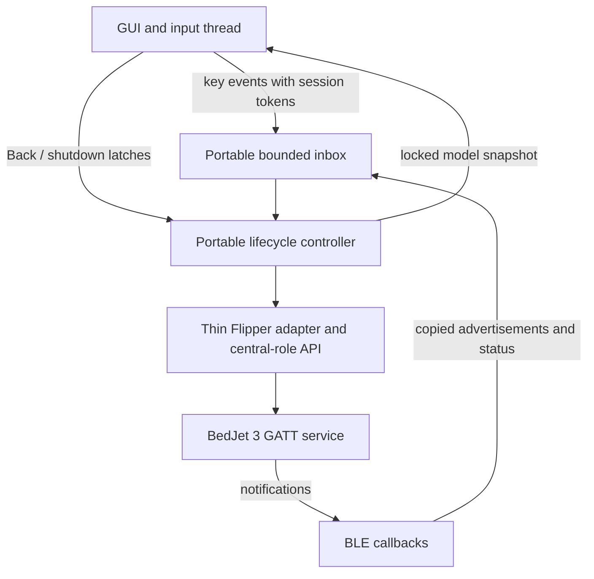

# Architecture and protocol boundaries

The app is one external Flipper application with a portable C protocol core and
a portable lifecycle controller. The GUI and host tests use the same controller.
All operations are local. There is no network service or persistent settings store.

The inbox has 24 fixed-size entries. Posting never waits for its atomic try-lock;
contended/full ordinary events are dropped and counted. Back and shutdown use
separate atomic latches. Session tokens reject old input and notifications after
cancellation or reconnect. No controller call runs inside a BLE or GUI callback.
Off prioritization and desired-state coalescing remain next-step work. Host
tests verify the portable paths; physical-radio behavior remains unverified.

## Files

| Path | Responsibility |
| --- | --- |
| `bedjet_protocol.h`, `.c` | UUIDs, exact command bytes, structural status validation |
| `bedjet_controller.h`, `.c` | Production lifecycle, bounded inbox, session tokens, status model and control policy |
| `bedjet_flipper.h`, `.c` | Pinned Flipper API adapter, callback conversion/drain boundary and clock |
| `bedjet_remote.c` | GUI/input wiring, worker tick loop and locked display snapshot |
| `application.fam` | Native Flipper application metadata and build inputs |
| `firmware.lock.json` | Upstream firmware commit, API and radio-stack requirements |
| `build.py` | Check pin, copy app sources, build FAP, optionally build update package |
| `tests/protocol_test.c` | Synthetic command/status tests and malformed-input cases |
| `tests/controller_test.c` | Real-controller lifecycle tests with a deterministic transport/clock fake and inbox stress |
| `scripts/check.py` | Portable local test runner and optional formatting check |
| `artifacts/prototype` | Initial compiled proof of concept and its provenance |

## GATT interface

| Purpose | UUID |
| --- | --- |
| Service | `00001000-bed0-0080-aa55-4265644a6574` |
| Status | `00002000-bed0-0080-aa55-4265644a6574` |
| Command | `00002004-bed0-0080-aa55-4265644a6574` |

UUID constants are stored in the STM32WB API's little-endian byte order.
Commands use Write Without Response, matching ESPHome's implementation.

| Operation | Bytes |
| --- | --- |
| Off / Cool / Heat / Dry / Extended Heat | `01 01` / `01 02` / `01 03` / `01 05` / `01 06` |
| Start M1 / M2 / M3 | `01 20` / `01 21` / `01 22` |
| Target temperature | `03 step`, where `step = Celsius * 2` |
| Fan | `07 step`, where `percent = (step + 1) * 5` |
| Timer | `02 hours minutes` |

The codec's button whitelist also recognizes the documented Turbo button code,
but the UI does not expose Turbo start. It excludes debug and firmware-update
commands. Do not infer implemented UI features from protocol constants alone.

## Status handling

The parser accepts the V3 status header with format `0x56` and packet type `1`.
It validates lengths, mode, fan index, temperature ranges and time components
before replacing output. It consumes core fields through byte 17. An ordinary
20-byte partial notification already contains those fields; the extended tail
is not reassembled or interpreted in this feature set.

Target temperature, mode, fan and time limits come from observed status. Writes
do not optimistically replace them. Fifteen-second freshness uses the callback's
receive timestamp rather than the time a queued notification is processed.
The current UI does not yet match a specific command intent to a subsequent
status or timeout. That is separate work from transport success.

The packet checksum has not been verified. The parser checks structure and
bounds, not integrity through a known checksum. Fixtures are synthetic. Hardware
captures must establish whether the real unit's header, advertised bounds and
off-state read format match these assumptions.

## Lifecycle

The native worker advances one lifecycle stage per tick through the portable
controller. It initializes the experimental API only when central support is
reported. It stops advertising before scanning, selects a unit, connects, discovers
command/status handles, subscribes and performs an initial read. Each stage calls
a bounded synchronous transport operation; cancellation is checked between stages.
Busy setup rejects ordinary controls. Reconnection requires a manual scan, starts
a new session and never replays commands. The injectable refresh operation reads
status without writing settings; it is not an automatic resync policy or a new UI
feature. Stale/off-state recovery beyond that boundary remains issue #5.

Teardown detaches the notification callback and invokes the API's deinitializer.
The pinned API documents detaching app callback contexts even if the controller
cannot complete termination immediately. The controller attempts deinitialization at most three times. It restores prior
advertising only after confirmed cleanup; on persistent deferral it records
`cleanup_deferred` and relies on the pinned API to have drained/detached app
callbacks even though the radio operation may remain tracked in firmware.
The host fake explicitly models that contract, including callbacks completing
during removal. It cannot prove the physical API honors it. These paths still
require hardware stress and stack/heap watermark checks before a release.

See [the harness coverage and contracts](testing.md).

## Reference confidence

The [community protocol document](https://github.com/roycamp/bedjet-protocol/blob/main/BEDJET_V3_BLUETOOTH_PROTOCOL.md)
explicitly says its author did not test the V3 consolidation on hardware. Core
commands and offsets were cross-checked against ESPHome. The central-role PR
author reports generic peripheral hardware tests; those do not validate BedJet.
See [third-party references](../THIRD_PARTY_NOTICES.md) and
[our validation evidence](validation.md).
