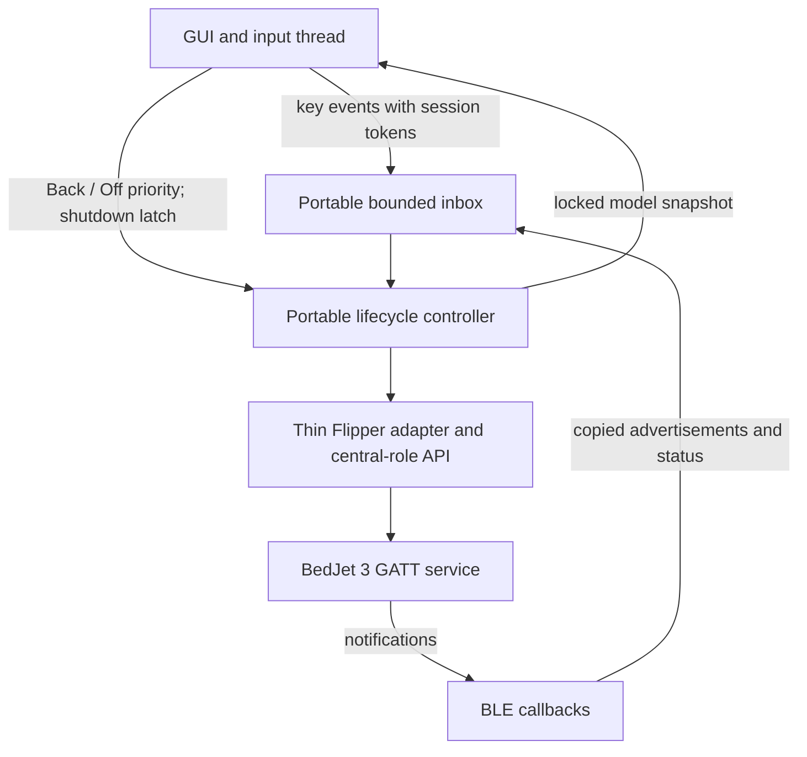

# Architecture and protocol boundaries

The app is one external Flipper application with a portable C protocol core and
a portable lifecycle controller. The GUI and host tests use the same controller.
All operations are local. There is no network service or persistent settings store.

The inbox has 24 fixed-size entries. Posting never waits for its atomic try-lock;
contended/full ordinary events are dropped and counted. Back and Off use
a session-bound atomic priority word, with shutdown as a global latch. Priority
flags and the session generation change atomically; stale producers cannot
cancel a replacement session. Off rotates that generation, drops older work and
rebinds notifications after draining the old callback. No controller call runs
inside a BLE or GUI callback. A separate ordinary-input generation discards
keys predating mode changes or failed intents. Host tests verify these paths;
physical-radio behavior remains unverified.

See the [cancellation policy and native wait budgets](cancellation.md).

## Files

| Path | Responsibility |
| --- | --- |
| `bedjet_protocol.h`, `.c` | UUIDs, exact command bytes, structural status validation |
| `bedjet_controller.h`, `.c` | Production lifecycle, bounded inbox, session tokens, status model and control policy |
| `bedjet_flipper.h`, `.c` | Pinned Flipper API adapter, callback conversion/drain boundary and clock |
| `bedjet_view.h`, `.c` | Portable display text: status badge, actual line, row labels, unit list and Info pages |
| `bedjet_remote.c` | GUI/input wiring, worker tick loop and locked display snapshot |
| `application.fam` | Native Flipper application metadata and build inputs |
| `firmware.lock.json` | Upstream firmware commit, API and radio-stack requirements |
| `build.py` | Check pin, copy app sources, build FAP, optionally build update package |
| `tests/protocol_test.c` | Synthetic command/status tests and malformed-input cases |
| `tests/controller_test.c` | Real-controller lifecycle tests with a deterministic transport/clock fake and inbox stress |
| `scripts/check.py` | Portable test runner (sanitizers fatal), static/doc-link checks and clang-format 18 check |
| `scripts/verify_artifact.py` | Verifies the retained prototype FAP size/hash and its archived source hashes without executing them |
| `tests/view_test.c` | Display labels, badges, units, unit list and Info pages |
| `.github/workflows/ci.yml` | Automatic host checks and pinned-firmware FAP build; never flashes or publishes |
| `artifacts/prototype` | Initial compiled proof of concept and its provenance |

## GATT interface

| Purpose | UUID |
| --- | --- |
| Service | `00001000-bed0-0080-aa55-4265644a6574` |
| Status | `00002000-bed0-0080-aa55-4265644a6574` |
| Command | `00002004-bed0-0080-aa55-4265644a6574` |

UUID constants are stored in the STM32WB API's little-endian byte order.
Commands use Write Without Response, matching ESPHome's implementation.

| Operation | Bytes |
| --- | --- |
| Off / Cool / Heat / Dry / Extended Heat | `01 01` / `01 02` / `01 03` / `01 05` / `01 06` |
| Start M1 / M2 / M3 | `01 20` / `01 21` / `01 22` |
| Target temperature | `03 step`, where `step = Celsius * 2` |
| Fan | `07 step`, where `percent = (step + 1) * 5` |
| Timer | `02 hours minutes` |

The codec's button whitelist also recognizes the documented Turbo button code,
but the UI does not expose Turbo start. It excludes debug and firmware-update
commands. Do not infer implemented UI features from protocol constants alone.

## Status handling

The parser accepts the V3 status header with format `0x56` and packet type `1`.
It validates lengths, mode, fan index, temperature ranges and time components
before replacing output. It consumes core fields through byte 17. An ordinary
20-byte partial notification already contains those fields; the extended tail
is not reassembled or interpreted in this feature set.

Target temperature, mode, fan and time limits come from observed status. Writes
do not optimistically replace them. Fifteen-second freshness uses the callback's
receive timestamp rather than the time a queued notification is processed.
A separate command model holds one pending target and one latest coalesced
temperature/fan target. Only strictly newer, matching status marks it Applied;
transport acceptance remains distinct. Timeouts/conflicts discard deferred intent
without retry. Mode changes lock temperature/runtime limits until matching status;
preset identity remains Unverified. See the [command policy](commands.md) for
field matching, timer tolerance, input generations and RF-remote conflict rules.

No V3 status checksum is known: ESPHome leaves it as a TODO and the Home
Assistant integration checks none. The parser therefore checks structure and
bounds only, and reports which rule rejected a frame (length, header, declared
length, runtime, mode, fan, temperature or limits). Fixtures are synthetic.

Reading the status characteristic is not assumed to return a status packet.
Both reference implementations read an 11-byte tail (bytes 20-30 of the full
32-byte layout: flags, update phase and a notify code) and decode mode,
temperature and runtime only from notifications. The initial read and manual
refresh therefore record the read's raw bytes and parse result as evidence and
update observed state only if the unit actually returns a validated status
frame. No tail decoder is added until captures confirm its format.

Per connection, the controller keeps accepted, rejected, late and oversize
frame counts, the last rejected frame with its reason, the last accepted frame
and the last read. Short frames are admitted to the inbox so they can be
recorded; oversize frames are counted. This is capture evidence for issue #2,
not looser parsing: only a validated status frame changes observed state.
Hardware captures must establish whether the unit's header, advertised bounds
and off-state behavior match these assumptions.

## Lifecycle

The native worker advances one lifecycle stage per tick through the portable
controller. It initializes the experimental API only when central support is
reported. It stops advertising before scanning, selects a unit, connects, discovers
command/status handles, subscribes and performs an initial read. Each stage calls
a synchronous transport operation with configured firmware wait budgets;
cancellation is checked between stages and after calls before publishing a model.
Busy setup rejects ordinary controls. Reconnection requires a manual scan, starts
a new session and never replays commands. A manual refresh re-enables
notifications (CCCD write) and reads the status characteristic once, at most
every three seconds. It never writes a BedJet command. There is no automatic
resync or reconnect: a unit in standby is expected to stop notifying, so a loop
would only add blocking firmware waits until hardware evidence shows otherwise.

Teardown detaches the notification callback and invokes the API's deinitializer.
The pinned API documents detaching app callback contexts even if the controller
cannot complete termination immediately. The controller attempts deinitialization at most three times. It restores prior
advertising only after confirmed cleanup; on persistent deferral it records
`cleanup_deferred` and relies on the pinned API to have drained/detached app
callbacks even though the radio operation may remain tracked in firmware.
The host fake explicitly models that contract, including callbacks completing
during removal. It cannot prove the physical API honors it. These paths still
require hardware stress and stack/heap watermark checks before a release.

See [the harness coverage and contracts](testing.md).

## Reference confidence

The [community protocol document](https://github.com/roycamp/bedjet-protocol/blob/main/BEDJET_V3_BLUETOOTH_PROTOCOL.md)
explicitly says its author did not test the V3 consolidation on hardware. Core
commands and offsets were cross-checked against ESPHome. The central-role PR
author reports generic peripheral hardware tests; those do not validate BedJet.
See [third-party references](../THIRD_PARTY_NOTICES.md) and
[our validation evidence](validation.md).
